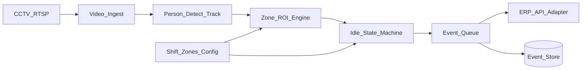
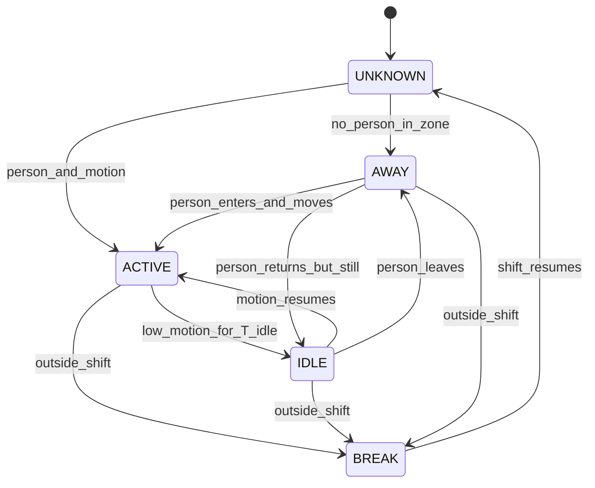
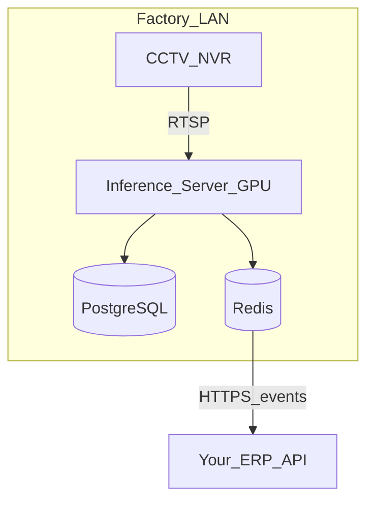

# Architecture — Employee Idle Time (Phase 1)

## Goal

Detect workstation **IDLE** (person present, low activity) and **AWAY** (no person during shift), measure duration, and POST events to the ERP/software API with retries and idempotency.

## Pipeline

## Components

| Component | Role | Config |
|-----------|------|--------|
| Video ingest | RTSP sub-stream pull, frame sample @ 5–10 FPS | `config/cameras.yaml` |
| Person detect + track | YOLOv8 + ByteTrack; pose for motion | hardware profile |
| Zone ROI engine | Point-in-polygon occupancy per workstation | `config/zones.yaml` |
| Idle state machine | ACTIVE / IDLE / AWAY / BREAK + thresholds | `config/idle_rules.yaml` |
| Event queue | Redis Streams decouple CV from HTTP | `config/erp_api.yaml` |
| ERP adapter | HTTPS POST, auth, backoff, DLQ | `config/erp_api.yaml` |
| Event store | PostgreSQL audit of all emissions | `DATABASE_URL` |

## State machine

## Deployment (on-prem)

Video stays on the factory LAN. Only structured events (and optional evidence paths) leave via HTTPS.

## Privacy

Anonymous `track_id` only — no face recognition in Phase 1.

## Implementation roadmap (post-architecture)

1. Spike: RTSP → YOLO person detect on `cam-01`
2. Zones + idle state machine + local event log
3. ERP API adapter + retries
4. Pilot calibrate with `recordings/`
5. Multi-camera scale + optional admin UI

## Related docs

- [Camera & zone inventory](camera-zone-inventory.md)
- [Idle rules](idle-rules.md)
- [API contract](api-contract.md)
- [Hardware sizing](hardware-sizing.md)
- [Pilot recordings](pilot-recordings.md)
- [Phase 2 deferred](phase2-deferred.md)
